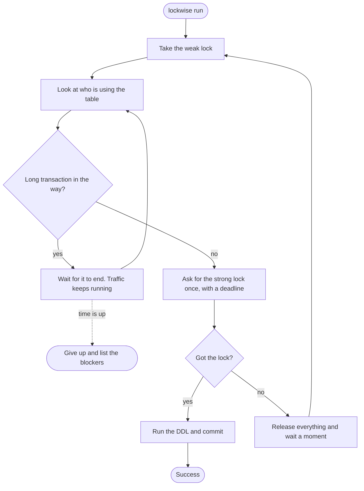

# lockwise

Runs a DDL on a hot Postgres table and pauses the table only once, for a time you choose.

It is a single binary that talks plain SQL to the server.

> Current state: prototype.

## The problem

{width=50%}

DDL locks on busy tables can lead to lock contention.

A DDL such as `ALTER TABLE` needs a strong lock. While it waits for that lock, every new query on the table queues behind it. On a busy table the queue grows fast, connections pile up and the application slows down or fails.

The usual answer is to ask for the lock with a short timeout and retry. Each request still stops the table for a moment. After hundreds of requests the migration gives up without running, and the contention happened anyway.

{width=50%}

## The idea, with a bridge

Think of a bridge that needs a quick repair. The cars are the queries. The repair event is the DDL.

To do the repair, the worker lowers the gate. No new car gets in, and he waits for the cars already on the bridge to leave. Then he performs the repair and reopens the bridge. Lowering the gate that blocks the bridge is the "strong lock".

The problem is a slow truck in the middle of the bridge. That is a long transaction. If the worker lowers the gate while the truck is there, he needs to wait for the truck to pass. Meanwhile the cars pile up at the gate.

The usual fix is to go to the entrance of the bridge and lower the gate. If a slow vehicle is still crossing and it takes too long, the worker raises the gate and returns later to try again. Every attempt piles up cars, and the truck is still there.

lockwise does this instead.

1. **The worker hangs a sign at the entrance, "maintenance scheduled".** The sign is the weak lock. Cars ignore it and keep crossing. The sign is for other maintenance crews. The street sweeper, which is autovacuum, leaves the bridge and stays away. Another worker with another repair waits for his turn.
2. **He watches the bridge.** Is there a slow truck? Then he waits. Cars keep crossing.
3. **When only fast cars are left, he lowers the gate.** The cars on the bridge leave in a moment. He performs the repair and reopens the bridge.

The gate still goes down once. It stays down for a short time, because the worker chose the moment.

## How lockwise solves it

{width=50%}

It does three things, in this order.

1. **Waits without getting in the way.** It first takes a weak lock, `SHARE UPDATE EXCLUSIVE`. This lock does not block reads or writes. It moves autovacuum out of the way and puts DDLs in a queue.
2. **Looks before it asks.** It checks who is using the table and for how long. If there is a long transaction, it waits for it to end. The table keeps working.
3. **Asks for the strong lock once, with a deadline.** If it gets the lock, it runs the DDL and releases. If a gap never shows up, it does not ask, and it tells you who is blocking.



## Advantages

- **The wait uses no XID.** A transaction that holds only the weak lock has no transaction ID. It does not hold back the vacuum horizon.
- **The wait does not grow snapshots.** With no XID, the waiting transaction does not show up in the snapshots of other sessions.
- **The wait does not block traffic.** Reads and writes keep running, and their locks stay on the fast path.
- **Autovacuum yields by itself.** A regular autovacuum on the table is cancelled after `deadlock_timeout`. No extra privilege is needed.
- **DDLs run in order.** Two migrations on the same table queue on the weak lock, in order of arrival.
- **One pause, with a known size.** The table is paused once, for at most `max_pause_ms`.
- **Blockers are named.** The `waiting` event lists the sessions in the way.

## Disadvantages

- **The strong lock request takes an XID.** A request for `ACCESS EXCLUSIVE` gets a transaction ID before it waits. While it waits, that XID grows the snapshots of other sessions and holds back the vacuum horizon. This also applies to a strong lock request from another session that waits behind the weak lock.
- **A strong lock request behind the weak lock queues traffic.** If another session asks for a strong lock while lockwise holds the weak lock, new queries queue behind that request until it times out.
- **Maintenance on the table waits.** While the weak lock is held, `VACUUM`, `ANALYZE` and `CREATE INDEX CONCURRENTLY` on that table wait.
- **The table is still paused once.** The pause lasts until the transactions in flight end, up to `max_pause_ms`.

## Usage

```bash
cargo build --release

target/release/lockwise run \
  --conn "host=localhost user=migrator dbname=app" \
  --preset presets/c1-window-3000ms.toml \
  --lock accounts:ael \
  --sql "ALTER TABLE accounts ADD COLUMN note text"
```

`--lock` takes the table and the mode. The modes are `ael` for `ACCESS EXCLUSIVE` and `sre` for `SHARE ROW EXCLUSIVE`.

The database user needs the `pg_monitor` role. Use a direct connection to Postgres.

## Configuration

The preset is a TOML file.

```toml
name = "c1-window-3000ms"
max_runtime_s = 120      # total time before giving up

[window]
max_pause_ms = 3000      # the longest the table may be paused
cooldown_ms = 10000      # time between attempts
poll_ms = 200            # how often it looks at the blockers
prelock_hold_s = 60      # how long it keeps the weak lock
```

The value that matters most is `max_pause_ms`. A shorter pause does less harm and needs a larger gap in traffic.

## Output

The tool writes one JSON event per line.

| Event | Meaning |
|---|---|
| `queued` | Started. |
| `prelocked` | Got the weak lock. |
| `waiting` | Waiting. Lists who is blocking. |
| `acquired` | Got the strong lock. |
| `result` | Finished, with success or gave up. |

The exit code is `0` for success, `2` for gave up and `1` for error.

## Tests

```bash
tests/run.sh
```

The script starts a throwaway Postgres and runs the end-to-end tests. It looks for the Postgres binaries in `~/.local/share/mise/installs/postgres/17.8/bin`. Set `PG_ROOT` and `VER` to use another location.
