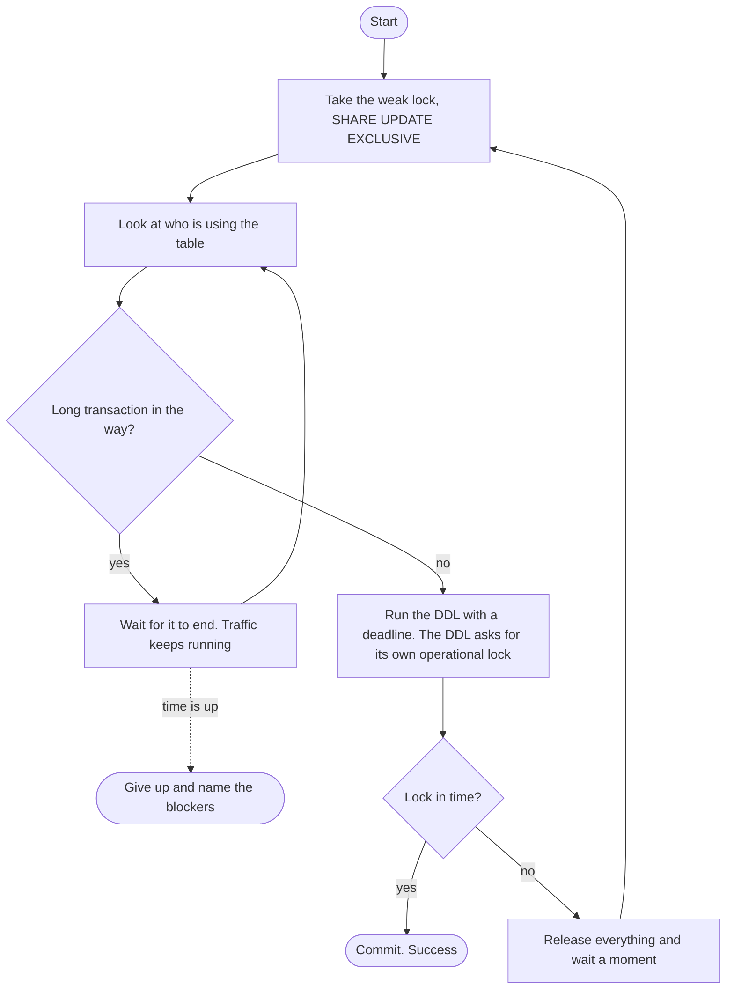

# lockwise

Runs a DDL on a hot Postgres table and limits how long the table can be paused.

It comes as a Ruby gem and as a single binary. Both follow the same steps and talk plain SQL to the server.

> Current state: prototype.

## The problem

{width=50%}

DDL locks on busy tables can lead to lock contention.

A DDL such as `ALTER TABLE` needs a strong lock. While it waits for that lock, every new query on the table queues behind it. On a busy table the queue grows fast, connections pile up and the application slows down or fails.

The usual answer is to ask for the lock with a short timeout and retry. Each request still stops the table for a moment. After hundreds of requests the migration gives up without running, and the contention happened anyway.

{width=50%}

## The idea, with a bridge

Think of a bridge that needs a quick repair. The cars are the queries. The repair event is the DDL.

To do the repair, the worker lowers the gate. No new car gets in, and he waits for the cars already on the bridge to leave. Then he performs the repair and reopens the bridge. Lowering the gate that blocks the bridge is the "strong lock".

The problem is a slow truck in the middle of the bridge. That is a long transaction. If the worker lowers the gate while the truck is there, he needs to wait for the truck to pass. Meanwhile the cars pile up at the gate.

The usual fix is to go to the entrance of the bridge and lower the gate. If a slow vehicle is still crossing and it takes too long, the worker raises the gate and returns later to try again. Every attempt piles up cars, and the truck is still there.

lockwise does this instead.

1. **The worker hangs a sign at the entrance, "maintenance scheduled".** The sign is the weak lock. Cars ignore it and keep crossing. The sign is for other maintenance crews. The street sweeper, which is autovacuum, leaves the bridge and stays away. Another worker with another repair waits for his turn.
2. **He watches the bridge.** Is there a slow truck? Then he waits. Cars keep crossing.
3. **When only fast cars are left, he lowers the gate.** The cars on the bridge leave in a moment. He performs the repair and reopens the bridge.

The gate still goes down once. It stays down for a short time, because the worker chose the moment.

## How lockwise solves it

{width=50%}

It does three things, in this order.

1. **Waits without getting in the way.** It first takes a weak lock, `SHARE UPDATE EXCLUSIVE`. This lock does not block reads or writes. It moves autovacuum out of the way and puts DDLs in a queue.
2. **Looks before it asks.** It checks who is using the table and for how long. If there is a long transaction, it waits for it to end. The table keeps working.
3. **Runs the DDL with a deadline.** The DDL asks for its own operational lock. If the lock comes in time, the DDL runs and everything is released. If it does not, lockwise releases everything, waits a moment and starts again. If a gap never shows up, it gives up and tells you who is blocking.



## What the weak lock blocks

The weak lock is `SHARE UPDATE EXCLUSIVE`. It conflicts with itself and with every stronger lock. The locks that traffic uses are weaker, so traffic passes.

These run while lockwise holds the weak lock.

| Operation | Lock it uses |
|---|---|
| `SELECT`, `COPY TO`, `pg_dump` | `ACCESS SHARE` |
| `REFRESH MATERIALIZED VIEW CONCURRENTLY` of a view that reads the table | `ACCESS SHARE` |
| `SELECT ... FOR UPDATE` | `ROW SHARE` |
| `INSERT`, `UPDATE`, `DELETE`, `MERGE` | `ROW EXCLUSIVE` |

These wait until lockwise releases the weak lock.

| Operation | Lock it uses |
|---|---|
| `VACUUM`, `ANALYZE` | `SHARE UPDATE EXCLUSIVE` |
| `CREATE INDEX CONCURRENTLY`, `REINDEX CONCURRENTLY`, `DROP INDEX CONCURRENTLY` | `SHARE UPDATE EXCLUSIVE` |
| `VALIDATE CONSTRAINT`, `CREATE STATISTICS` | `SHARE UPDATE EXCLUSIVE` |
| `CREATE INDEX` | `SHARE` |
| `CREATE TRIGGER`, adding a foreign key | `SHARE ROW EXCLUSIVE` |
| `ALTER TABLE ADD COLUMN`, `TRUNCATE`, `DROP TABLE`, `VACUUM FULL`, `CLUSTER`, `REINDEX TABLE` | `ACCESS EXCLUSIVE` |

A regular autovacuum does not wait. It skips the table. The DDL that lockwise runs is not blocked either, because it runs in the transaction that holds the weak lock.

## Advantages

- **The wait uses no XID.** A transaction that holds only the weak lock has no transaction ID. It does not hold back the vacuum horizon.
- **The wait does not grow snapshots.** With no XID, the waiting transaction does not show up in the snapshots of other sessions.
- **The wait does not block traffic.** Reads and writes keep running, and their locks stay on the fast path.
- **Autovacuum yields by itself.** A regular autovacuum on the table is cancelled after `deadlock_timeout`. No extra privilege is needed.
- **DDLs run in order.** Two migrations on the same table queue on the weak lock, in order of arrival.
- **The DDL takes only the lock it needs.** A foreign key stops writes for a moment and lets reads run.
- **The pause has a limit.** A lock request waits for at most `max_pause`.
- **Blockers are named.** When it gives up, lockwise lists the sessions in the way.

## Disadvantages

- **The strong lock request takes an XID.** A request for `ACCESS EXCLUSIVE` gets a transaction ID before it waits. While it waits, that XID grows the snapshots of other sessions and holds back the vacuum horizon. This also applies to a strong lock request from another session that waits behind the weak lock.
- **A strong lock request behind the weak lock queues traffic.** If another session asks for a strong lock while lockwise holds the weak lock, new queries queue behind that request until it times out.
- **Maintenance on the table waits.** While the weak lock is held, `VACUUM`, `ANALYZE` and `CREATE INDEX CONCURRENTLY` on that table wait. lockwise releases the weak lock from time to time to give them a turn.
- **The table is still paused.** The pause lasts until the transactions in flight end, up to `max_pause`. A request that times out pauses the table too.

## Usage

### Ruby gem

```ruby
gem 'lockwise', git: 'https://gitlab.com/l.rosa/lockwise', glob: 'ruby/*.gemspec'
```

Pass the connection and the table, and run the DDL in the block. In a Rails migration the transaction belongs to lockwise, so the migration turns its own off.

```ruby
class AddNoteToAccounts < ActiveRecord::Migration[8.0]
  disable_ddl_transaction!

  def up
    Lockwise.with_lock(connection, 'accounts') do
      add_column :accounts, :note, :text
    end
  end
end
```

The connection can be an ActiveRecord connection or a `PG::Connection`.

The block can run more than once. When its lock request times out, lockwise rolls the transaction back and calls the block again. Keep only the DDL in it.

#### Several tables

Pass a list. lockwise takes the weak lock on all of them and waits for long transactions on any of them.

To control the order of the strong locks, ask for the lock by name. lockwise then takes it before the block runs, on the tables in the order given. Put the busiest table first.

| Option | Lock taken before the block | Use it for |
|---|---|---|
| none | none, the DDL asks for its own | one table, one statement |
| `share_row_exclusive: true` | `SHARE ROW EXCLUSIVE` | adding a foreign key, creating a trigger |
| `access_exclusive: true` | `ACCESS EXCLUSIVE` | removing a foreign key, swapping two tables |

Adding a foreign key needs `SHARE ROW EXCLUSIVE` on both tables. Reads keep running.

```ruby
class AddOwnerForeignKeyToAccounts < ActiveRecord::Migration[8.0]
  disable_ddl_transaction!

  def up
    Lockwise.with_lock(connection, %w[owners accounts], share_row_exclusive: true) do
      add_foreign_key :accounts, :owners, validate: false
    end

    validate_foreign_key :accounts, :owners
  end
end
```

Removing a foreign key needs `ACCESS EXCLUSIVE` on both tables.

```ruby
class RemoveOwnerForeignKeyFromAccounts < ActiveRecord::Migration[8.0]
  disable_ddl_transaction!

  def up
    Lockwise.with_lock(connection, %w[owners accounts], access_exclusive: true) do
      remove_foreign_key :accounts, :owners
    end
  end
end
```

#### Options

| Option | Default | Meaning |
|---|---|---|
| `max_pause` | `3.0` | the longest a lock request may wait, in seconds |
| `max_runtime` | `120.0` | total time before giving up |
| `cooldown` | `10.0` | time between attempts |
| `poll` | `0.2` | how often it looks at the blockers |
| `weak_lock_hold` | `60.0` | how long it keeps the weak lock before releasing it for a moment |

The value that matters most is `max_pause`. A shorter pause does less harm and needs a larger gap in traffic.

#### Errors

| Error | When |
|---|---|
| `Lockwise::GaveUpError` | The time ran out. `reason` says why and `blockers` lists the sessions in the way. |
| `Lockwise::TransactionOpenError` | The connection was already in a transaction. |

### Binary

```bash
cd rust
cargo build --release

target/release/lockwise run \
  --conn "host=localhost user=migrator dbname=app" \
  --preset presets/c1-window-3000ms.toml \
  --table accounts \
  --sql "ALTER TABLE accounts ADD COLUMN note text"
```

Repeat `--table` for several tables. Add `--share-row-exclusive` or `--access-exclusive` to take that lock before the SQL runs, on the tables in the order given.

The preset is a TOML file with the same settings as the gem.

```toml
name = "c1-window-3000ms"
max_runtime_s = 120

[window]
max_pause_ms = 3000
cooldown_ms = 10000
poll_ms = 200
prelock_hold_s = 60
```

The binary writes one JSON event per line.

| Event | Meaning |
|---|---|
| `queued` | Started. |
| `prelocked` | Got the weak lock. |
| `waiting` | Waiting. Lists who is blocking. |
| `acquired` | The SQL got its lock and ran. |
| `result` | Finished, with success or gave up. |

The exit code is `0` for success, `2` for gave up and `1` for error.

## Requirements

The database user needs the `pg_monitor` role, to see the transactions of other users. Use a direct connection to Postgres.

## Tests

```bash
rust/bin/test   # the binary
ruby/bin/test   # the gem
```

Each script starts a throwaway Postgres and runs the tests against it. They look for the Postgres binaries in `~/.local/share/mise/installs/postgres/17.8/bin`. Set `PG_ROOT` and `VER` to use another location.
